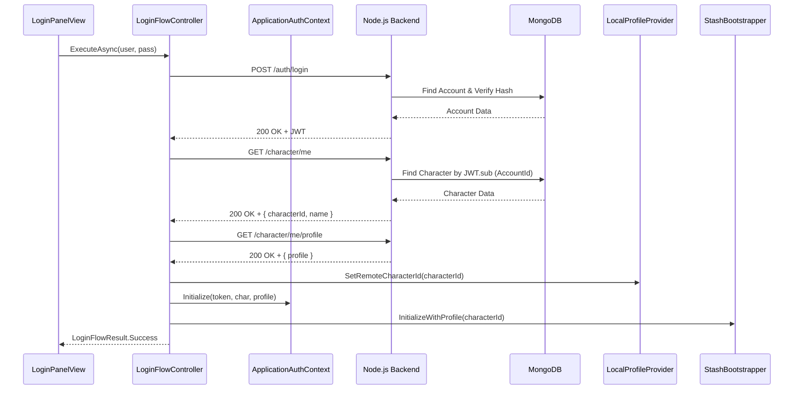

# Remote Identity and Authentication Architecture

## Context

Project Grimhold is transitioning towards a persistent, authoritative backend architecture. To support persistent progression, inventory, and social features, players require stable, globally unique identities that transcend local device state. Previously, identities were generated locally per-process as random GUIDs.

## Decision

The backend Node.js + MongoDB infrastructure is the sole authority over player accounts and characters. Unity authenticates with the backend and receives a token and an identity, which it then uses for all subsequent interactions.

### Authentication & Authorization

1.  **Identity Provider**: A custom Express.js backend running against a MongoDB instance.
2.  **Authentication Protocol**: HTTP POST to `/auth/login` with `username` and `password`.
3.  **Token Standard**: JSON Web Tokens (JWT) signed using a symmetric secret (`JWT_SECRET`).
4.  **Token Lifecycle**:
    *   Tokens are short-lived (configurable via `JWT_EXPIRES_IN`).
    *   The `sub` claim contains the internal `AccountId`.
    *   Tokens are passed in the `Authorization: Bearer <token>` header for all authenticated requests.
    *   Unity treats the JWT as an opaque string. It never attempts to decode or validate the signature client-side.
    *   The JWT also carries `jti` (unique per token) and `sid` (the refresh-token family it belongs to; see *Access Token Renewal*). Tokens issued before FIX-34 have no `sid` and remain valid until they expire.
5.  **Renewal**: `/auth/login` and `/auth/register` also return a rotating refresh token, exchanged through `POST /auth/refresh` (FIX-34, below).

### Access Token Renewal (FIX-34)

A long Town + Raid session must outlive the short-lived JWT without interrupting the player or destroying local services. The decision is a **rotating refresh token** (not silent re-login, which would require keeping the password, nor a longer JWT lifetime, which would widen the exposure of a leaked token).

**Backend contract**

*   `POST /auth/login` and `POST /auth/register` return `{ token, expiresIn, refreshToken, refreshExpiresIn }`; both expirations are in seconds.
*   **Refresh token**: opaque random value. The backend stores only its SHA-256 hash in the `RefreshToken` collection (`accountId`, `familyId`, `tokenHash`, `expiresAt`, `usedAt`, `successorHash`, `revokedAt`); the raw value is never persisted or logged. Lifetime is `JWT_REFRESH_EXPIRES_IN` seconds (placeholder default `86400`, 24 h; Game Design has not defined it). A MongoDB TTL index on `expiresAt` prunes expired records.
*   **Family**: every login/register starts a new family (`familyId`). The access JWT carries it as `sid`. Rotation keeps the family; separate logins are independent families, so revoking one device never affects another.
*   `POST /auth/refresh` (unauthenticated, IP rate limited; body `{ refreshToken }`, non-empty string of bounded length):
    *   Valid, unused, unexpired and unrevoked token: it is marked used with an atomic conditional update (`usedAt: null` → now), so it is **single use**, and the response is `200 { token, expiresIn, refreshToken, refreshExpiresIn }` with a new JWT and a new refresh token of the same family (each rotation grants a fresh lifetime).
    *   Unknown, expired or revoked token: `401 REFRESH_INVALID`.
    *   **Reuse detection**: presenting an already-used token **after the reuse grace window** revokes the whole family (including its newest token) and returns `401 REFRESH_INVALID`.
    *   **Reuse grace window (FIX-34, owner decision)**: a refresh response can be lost in transit (the backend rotated, the client never received the new pair), and the client then retries with the same, now used, token. Strict reuse detection would revoke the family and log the player out mid-raid. Therefore a used token presented again within `JWT_REFRESH_REUSE_GRACE_SECONDS` (default `30`; `0` restores strict behavior; negative or non-numeric values fail startup) of its **first use**, while neither revoked nor expired, is treated as a retry: the response is `200` with a new pair of the same family, `usedAt` keeps its original time (a retry does not extend the window), and the previously issued successor is revoked if it is still unused. A successor that was already exchanged is not touched. Each token stores the hash of its newest successor (`successorHash`); a single atomic update swaps it, so each retry learns exactly which successor it displaced. The lost successor then answers `401 REFRESH_INVALID` without revoking the family.
    *   **Trade-off**: inside the window a stolen, already-rotated token can mint one live successor (displacing the legitimate one); the legitimate client's next refresh then fails and signs the player out. The exposure is bounded by the window and requires possession of a refresh token that only ever lives in client memory.
    *   **Concurrency**: of several simultaneous requests with the same token exactly one consumes it (`usedAt: null` → now); inside the grace window the others are indistinguishable from retries and may also answer `200`, but each displaces the previous successor, so exactly **one** unused, unrevoked successor remains and the family is not revoked. Outside the window (or with grace `0`) the others are reuse: the family is revoked and nothing stays live. Clients should still refresh single-flight.
*   `authenticate` error codes (HTTP 401, other behavior unchanged):
    *   `TOKEN_EXPIRED`: a correctly signed access JWT whose `exp` has passed. This is the only code that triggers a refresh.
    *   `UNAUTHORIZED`: missing/malformed header, invalid signature, malformed token or revoked token. Not recoverable by refreshing.
    *   `REFRESH_INVALID`: returned only by `POST /auth/refresh`.
*   **Logout** additionally revokes the family of the presented JWT's `sid` (every token, including successors issued by grace retries), so its refresh tokens can no longer be exchanged. A JWT without `sid` (pre-FIX-34) logs out as before.
*   **Residual window**: revoking a family does not revoke access JWTs already issued from it other than the one presented at logout; they stop working at their natural `exp` (short-lived) and cannot be renewed.

**Unity client contract**

*   `ApplicationAuthContext` keeps the refresh token in memory only, beside the access token. It is never written to disk, PlayerPrefs, logs or UI, and is discarded with the access token on logout or reset.
*   At the shared authenticated HTTP choke point, `401 TOKEN_EXPIRED` triggers **one single-flight refresh** shared by all concurrent requests; the original request is retried **once** with the new token. Requests issued while a refresh is in flight wait for it (this is also how inventory synchronization is deferred until credentials are valid again). The refresh does **not** run `HandleUnauthorizedSession` and does **not** reset identity or stash.
*   `401 REFRESH_INVALID`, a failed refresh, a second `TOKEN_EXPIRED` after a refresh, or `401 UNAUTHORIZED` follow the existing unauthorized path (`HandleUnauthorizedSession` → `ResetForLogout`) with a clear Spanish message. A transport failure of the refresh is a retryable backend failure, not an authentication invalidation.

### Data Model & Boundaries

The backend maintains strict separation between the authentication concept (`Account`) and the gameplay concept (`Character`).

*   **Account**: Represents login credentials (`username`, `passwordHash`).
*   **Character**: Represents the player's avatar in the game world (`name`, `profile`).
    *   Currently, the system enforces a strict 1:1 relationship: One Account owns exactly One Character.
    *   The `accountId` acts as the foreign key linking a Character to an Account.
    *   **AccountId Opacity**: The `AccountId` is strictly an internal backend construct. It never travels in JSON response bodies to Unity, nor is it stored in Unity's memory. It only exists within the JWT `sub` claim.
*   **CharacterId / ProfileId**: The canonical identifier for a character is its MongoDB `_id` (`ObjectId`). When serialized to Unity, this is sent as the `characterId`.
    *   Unity adopts this remote `CharacterId` as its local `ProfileId`.
    *   This is the identity used for Town matchmaking, Stash allocation, and Fusion networking.

### Unity Client Architecture

#### Backend Configuration Selection (FIX-58)

Every Unity service (`LoginFlowController`, `MainMenuController`, `RemoteInventoryService`, `ProfileReconciliationService`, `RemoteShopTransactionService`, `RemoteAbilityPurchaseService`, `RemoteMissionClaimService`, `ApplicationStashServiceBootstrapper`, `TownInventoryBinder`, `ProfileDebugUtility`) resolves its active `BackendConfiguration` exclusively through the single source of truth `Grimhold.Backend.BackendConfigurationProvider` — no service loads `"BackendConfiguration"` by name from `Resources`.

*   **Resolution order**: explicit runtime/test override (`BackendConfigurationProvider.SetActiveOverride`) -> development local toggle (`Resources/BackendConfiguration_Local.asset`) -> `ApplicationAuthContext.Instance.BackendConfig` -> `LoginFlowController.Instance.Config` -> caller serialized fallback -> default `Resources/BackendConfiguration.asset`.
*   **Switching to localhost in development (without modifying versioned assets)**:
    *   **Unity Editor**: use the menu `Grimhold → Backend → Use Local Backend (localhost:3000)` (stored in `EditorPrefs` under `Grimhold.Backend.UseLocalConfiguration`) or switch back via `Grimhold → Backend → Use Deployed Backend (Render)`.
    *   **Editor or Development Build (including multi-process Duo tests)**: set the environment variable `GRIMHOLD_USE_LOCAL_BACKEND=1` (also accepts `true`, `local`, `yes`) before launching the process.
    *   **Release builds**: local overrides are compiled out (`!UNITY_EDITOR && !DEVELOPMENT_BUILD` always returns `false`), ensuring production builds always target the configured deployed endpoint.

The authentication flow is orchestrated by `LoginFlowController`, a non-UI component that executes the sequence:

1.  `AuthenticationClient.PostLoginAsync` -> Retrieves JWT.
2.  `CharacterClient.GetCharacterAsync` -> Retrieves `CharacterId` and name.
3.  `CharacterClient.GetProfileAsync` -> Retrieves the profile snapshot (e.g., `customNote`, `lastSeen`).
4.  Injects the remote `CharacterId` into `LocalProfileProvider`.
5.  Populates `ApplicationAuthContext` with the active token and character data.
6.  Invokes `ApplicationStashServiceBootstrapper.InitializeWithProfile` to spin up the local stash bound to this identity.

### Logout & Session Revocation Lifecycle (US-60)

The session lifecycle is completed by allowing the user to explicitly log out from the Town or MainMenu. Under US-60, logout provides authoritative server-side session invalidation:

1.  **UI Trigger**: The player clicks "Logout" in the Town menu or MainMenu.
2.  **Session Disconnect**: The `SessionConnectionCoordinator` cleanly tears down the active network runner (e.g. disconnecting from the Town) and returns the application state to the MainMenu.
3.  **Client-Side Teardown & Backend Revocation**: `LoginFlowController.ExecuteLogoutAsync()` is called, which:
    *   Calls the backend `POST /auth/logout` endpoint with the active JWT (`Authorization: Bearer <token>`). The backend also revokes the refresh-token family of the JWT's `sid` (see *Access Token Renewal*).
    *   **Authoritative Revocation**: The backend computes a SHA-256 hash of the token (`tokenHash`), extracts its `jti` (unique UUID embedded upon issuance) and natural expiration (`exp`), and stores a record in the MongoDB `RevokedToken` collection.
    *   **Automated Pruning**: A MongoDB TTL index on `expiresAt` (`expireAfterSeconds: 0`) ensures revoked tokens are automatically deleted once they naturally expire, preventing unbounded database growth.
    *   **Rejection of Revoked Tokens**: The `authenticate` middleware checks incoming token hashes against `RevokedToken.exists({ tokenHash })`. Any request presenting a revoked token is rejected with `401 UNAUTHORIZED` ("Token has been revoked."). Other concurrent sessions remain unaffected because tokens are hashed individually.
    *   Invokes `ApplicationStashServiceBootstrapper.ResetForLogout()` to tear down the in-memory Stash and Loadout state for the previous user. The context GameObject is kept alive to support subsequent logins without a process restart.
    *   Clears the local `ApplicationAuthContext` (discarding the JWT and the refresh token).
    *   Clears the `LocalProfileProvider` (discarding the remote `CharacterId`).
4.  **Re-authentication**: The player is returned to the `LoginPanelView` and can authenticate with a different account. A successful new login will re-initialize the `ApplicationStashServiceBootstrapper` with the new account's `ProfileId`.

### Security Hardening & Rate Limiting (US-60)

To protect the authentication and gameplay infrastructure in staging and production environments, the backend implements defense-in-depth controls:

1.  **Rate Limiting**:
    *   **IP Sliding Window Limiter**: Guards `/auth/login` and `/auth/register` (e.g., 20 requests per minute per IP), preventing denial-of-service and credential stuffing floods. Exceeding the threshold returns `429 TOO_MANY_REQUESTS`.
    *   **User Failed Login Limiter**: Tracks failed authentication attempts per username/account (e.g., 5 failures within 15 minutes). Once locked out, further login attempts for that account return `429 TOO_MANY_REQUESTS` ("Account temporarily locked due to too many failed attempts. Please try again later."). Successful login immediately resets the failure counter.
    *   **Unity Client Handling (FIX-26)**: `LoginFlowController` uses the pure Spanish `BackendErrorMessages` catalog for `TOO_MANY_REQUESTS`, including the rounded-up wait in seconds below 60 s or minutes from 60 s when supplied; it never presents the backend's diagnostic message. Login/register remain explicit user attempts (no automatic credential replay). `AuthenticationClient`, `CharacterClient`, `InventoryClient` and `ProgressionClient` preserve optional body `retryAfter` seconds and the `Retry-After` response header (strict unsigned integer delta seconds or RFC 1123 HTTP date only) in `BackendError.retryAfter`; when both exist the longer wait wins. Absent hints remain zero. See the classification and bounded idempotent retry policy in [Local Player Persistence](LocalPlayerPersistenceArchitecture.md#backend-error-classification-and-retry-fix-26).
2.  **Environment Hardening**:
    *   **Production Secret Enforcement**: In `production` (`NODE_ENV === 'production'`), weak or default JWT secrets are strictly rejected; secrets must be at least 32 characters long.
    *   **Debug & Mock Route Elimination**: Development helper routes (`/character/debug/mock-fusion-result`, `/character/me/inventory/extraction`) are gated behind dynamic environment getters (`enableDebugRoutes`, `enableLegacyExtraction`). In `production`, these routes are permanently disabled and return `404 Not Found`.
    *   **500 Error Sanitization**: Unhandled exceptions in the Express pipeline are sanitized by `errorHandler`. Internal error messages, database schemas, and stack traces are suppressed, returning a safe, generic payload: `{ error: "INTERNAL_SERVER_ERROR", message: "An unexpected error occurred." }`.

### Constraints & Future Work

*   **No Direct DB Access**: Unity never talks directly to MongoDB. All communication is via HTTP REST to the backend.
*   **Fusion Identity & Session Verification (US-59 / SEC-59.1)**: Photon Fusion receives the `ProfileId` to identify players in a session. Under US-59, the client does not demonstrate identity merely with a locally declared `ProfileId`, visible name or controlling a `PlayerObject`.
    - **Town Session Verification**: The backend acts as the sole authoritative issuer, generating a short-lived `TownSessionTicket` via `POST /character/me/session-ticket/town` signed with HMAC-SHA256 (`characterId`, `characterName`, `sessionName: 'Lobby-Town'`, `expiresAt`). The Town State Authority (`TownPartyDirectory`, `TownMerchantNetworkController`) verifies this ticket via `ITownSessionTicketVerifier` before authorizing party modifications or merchant operations.
    - **Sender Binding (FIX-54)**: The `TownSessionTicket` is a credential and is never replicated (`SocialPlayerIdentity` carries no ticket). Each client delivers its ticket only to the current State Authority of every Town authority object (`TownPartyDirectory`, `TownRaidPreparationDirectory`, `TownRaidPreparationNetworkController`, `TownMerchantNetworkController`) through the targeted static RPC `SocialPlayerIdentity.RPC_RegisterTownSender`. The runner-scoped `TownSenderIdentityContext` binds the ticket's profile to the RPC source `PlayerRef` (`RpcInfo.Source`) in `TownSenderIdentityRegistry`; payload fields never name the sender. Only a verified binding blocks other claimants: an unverified claim (for example a forged, unsigned ticket) is kept as a candidate and evicted once verification rejects it, and among genuine claims of one profile the earliest registration owns it. A bound sender cannot switch profiles, and bindings are released when the player leaves. Every authoritative Town RPC resolves its sender only through this verified binding (`TownSenderIdentityValidator.TryResolveVerifiedSender`), which also requires the sender's visible `SocialPlayerIdentity.ProfileId` to match. Non-authority peers resolve other players only for presentation, from the replicated claim, and never authorize with it. When the State Authority changes, clients detect the new authority `PlayerRef` and register again.
    - **Residual Trust (Shared Mode)**: The Town State Authority peer (master client) still receives the tickets delivered to it, and a peer holding a genuine copy of another player's ticket can own that profile if it registers first. Binding the ticket to the Photon session (custom authentication) is future work; moving Town to Host/Server mode is out of scope.
    - **Authoritative Raid Admission**: Clients obtain an `AuthoritativeRaidAdmissionTicket` via `POST /character/me/raid/admission-ticket`, binding their connection to an active backend `pendingReservation` (`reservationId`, `raidCode`, `characterAttributes`, `level`, `experience`, `preparedAbilities`, `items`, `preparedEquipment`). The Raid Host verifies the ticket via `IRaidAdmissionVerifier` and spawns the avatar using exclusively the backend-verified snapshot, rejecting client-fabricated attributes or unreserved items.
    - **Authenticated launch gate (FIX-55)**: Before either a Host or Client creates its fresh Raid runner, the backend reservation save must succeed and an authoritative admission ticket must be obtained and decoded. Rejection, Unauthorized, transport failure or an unusable ticket aborts the launch; there is no authenticated local-snapshot fallback. The same authentication predicate is used before the Town preparation ACK: authenticated session, backend configuration and non-empty token. A missing remote inventory service rejects preparation. Offline/Editor without that backend session preserves the existing local-snapshot path (`TicketSkipped`). This gate does not change the Host's own admission data or introduce ticket-based hydration of its seat.
    - **Unauthorized recovery (FIX-55, amended by FIX-34)**: An expired access token (`TOKEN_EXPIRED`) is not an authentication invalidation: the client refreshes it and retries once without any reset (see *Access Token Renewal*). Only `UNAUTHORIZED`, `REFRESH_INVALID` or a failed refresh keep the existing invalidation order, including identity/stash reset. Networking aborts without starting a runner and ends in a defined `Failed` state with a consumable `LoadoutReservationFailed`; it does not attempt Town startup with the reset identity/store. The pending reservation is retained for the existing login orphan resolution. Consistency under Unauthorized or an unreachable backend is deferred until the next login/backend access, not guaranteed immediately by the abort.
    - **Issuer Secrets Isolation**: Neither `JWT_SECRET` nor backend private keys are compiled into client builds. Verification is performed through backend endpoints or decoupled verifier interfaces.
*   **HTTPS**: Development currently occurs over HTTP. Production deployments must enforce HTTPS for all backend communication to secure credentials and JWTs in transit.
*   **Temporary Persistence**: While `customNote` and `lastSeen` persist remotely, core gameplay state (Stash, Loadout, Receipts) currently remains local and temporary per process (as defined in `LocalPlayerPersistenceArchitecture.md`). Subsequent roadmap stages will migrate these to the authoritative backend.
*   **Authoritative Session Revocation**: Accomplished in US-60 via SHA-256 token hashing and MongoDB TTL collections.
*   **Extraction Result Producer Boundary & Bounded Host Trust (TASK-223 / SEC-223 / #400)**:
    - **No Client Secrets**: Client assets and builds do not contain `WebhookSecret` or static signing keys.
    - **Dedicated Server Target Architecture (#400)**: In dedicated or worker deployments, `WEBHOOK_SECRET` is held exclusively on secure server infrastructure. Payloads signed with this secret are verified via HMAC-SHA256 over the canonical representation.
    - **Bounded Player-Host Authority (MVP)**: In peer-to-peer / player-hosted sessions, the host submits extraction results authenticated via JWT without holding cluster secrets. The backend enforces strict server-side bounds:
        1. Target character must exist and possess an active `pendingReservation` (`422 NO_ACTIVE_RESERVATION`). The reservation stays active, marked `admittedAt`, from admission until the extraction commit or a loss clear consumes it.
        2. Host must be a validated participant in the raid session (`403 HOST_NOT_IN_RAID`).
        3. Item count is bounded by player loadout capacity (maximum 30 slots, `422 EXCEEDS_INVENTORY_CAPACITY`), with valid loot identifiers and quantities (1..999, `422 INVALID_ITEM_SPECIFICATION`).
        4. Experience is capped by the raid budget (maximum 5,000 XP, `422 EXCEEDS_EXPERIENCE_BUDGET`).
        5. Forged or mismatched signatures are rejected with `401 INVALID_HOST_SIGNATURE`.
    Full details and anti-replay invariants are specified in `ExtractionArchitecture.md`.

